# PixelBoss (AI Virtual Company)

로컬·GitHub 프로젝트를 24시간 관리하는 **복셀 3D 가상 오피스 대시보드**입니다.
사용자가 회의실에 팀장들을 소집해 상위 지시를 내리면, 각 부서가 먼저 **읽기 전용 한글 제안**을 보고합니다.
사용자가 제안별로 진행/보류를 고르면 개발팀이 프로젝트별 전용 git 브랜치에서 구현하고,
QA 검수 → 수정 → 최종 반영 결정까지 이어집니다. 모든 에이전트는 백엔드의 독립된 Claude Code PTY 세션으로 동작합니다.
프로젝트 개수에 제한이 없고, 프로젝트가 늘면 책상과 사무실도 함께 커집니다.

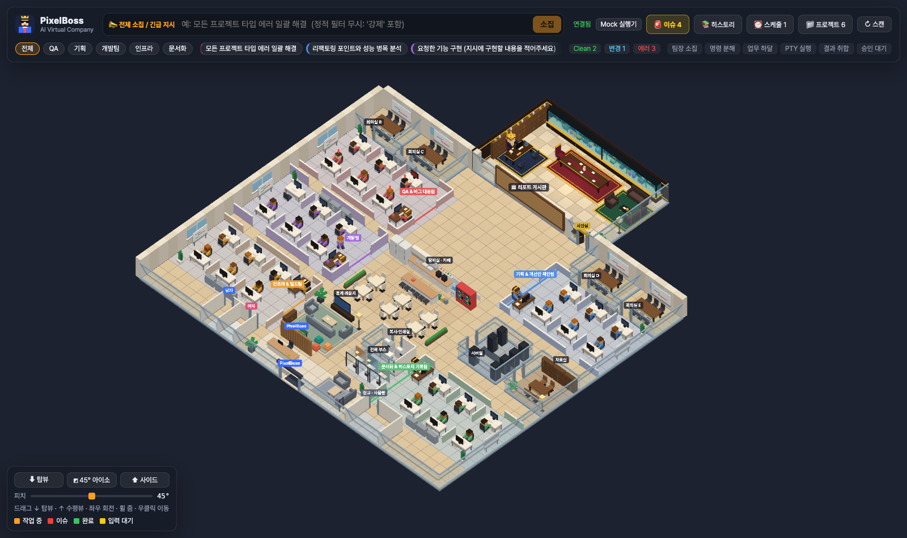

## 화면 미리보기

| 개발팀 구현 중 | 파이프라인 진행판 |
| --- | --- |
| 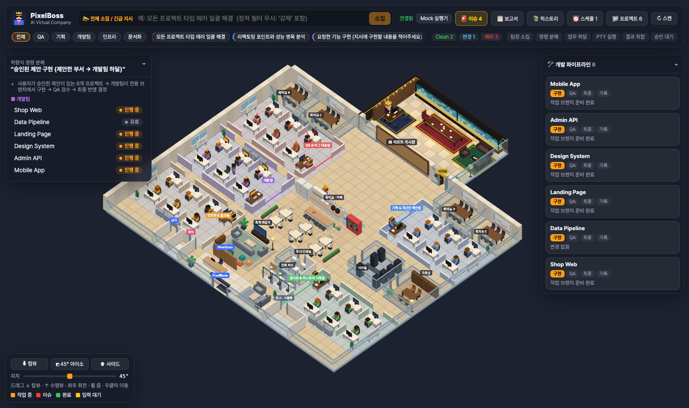 | 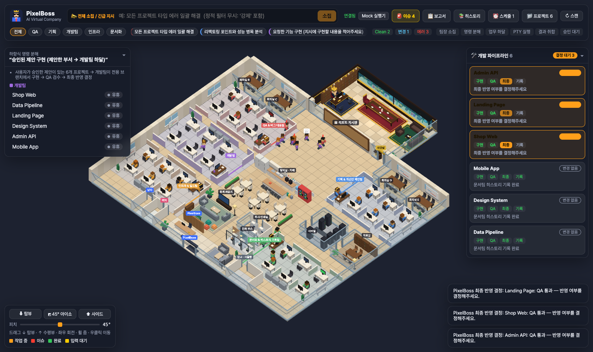 |
| **팀장 취합 보고서 (제안별 진행/보류)** | **최종 반영 결정 (diff 확인)** |
| 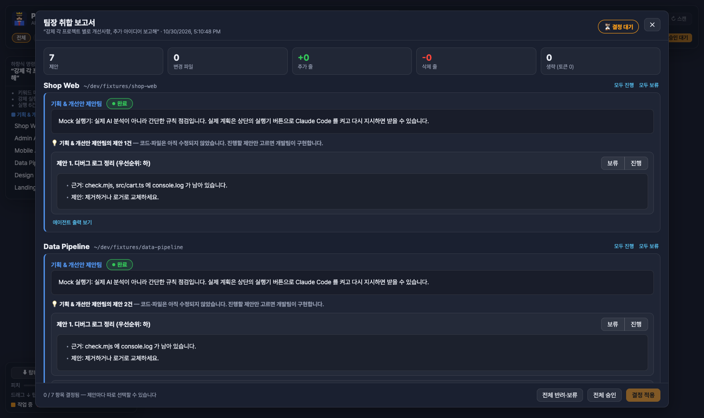 | 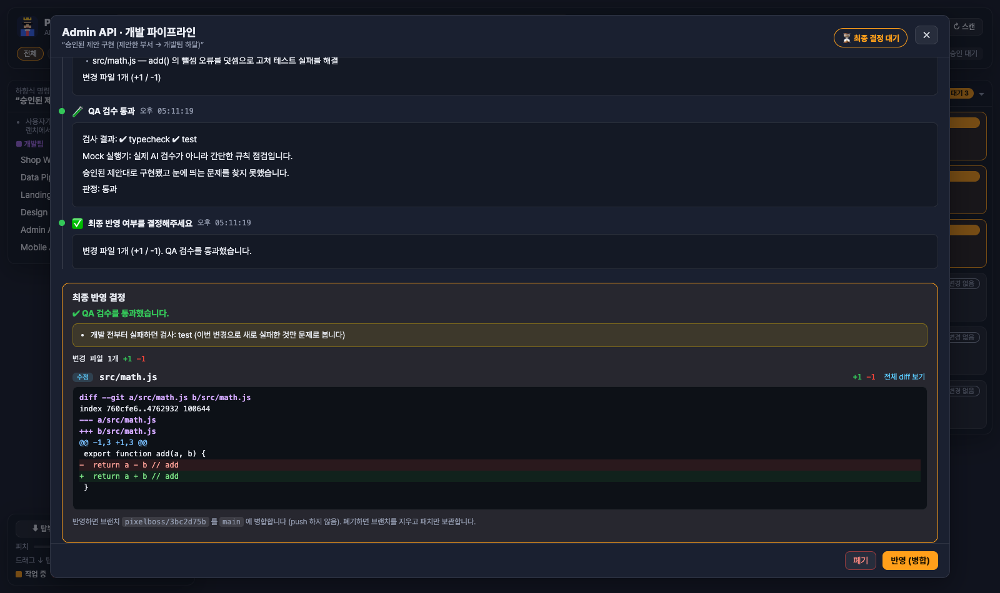 |

## 빠르게 실행하기

```bash
pnpm install
pnpm fixtures        # 검증용 가상 프로젝트 6개를 ./fixtures 에 생성 (선택)
pnpm dev             # 백엔드(ws://127.0.0.1:4100) + 프론트엔드(http://localhost:3000)
```

기본 실행기는 **mock** 이라 LLM 을 호출하지 않습니다. 실제 Claude Code 로 돌리려면 상단의 **실행기 버튼**(Mock 실행기 → Claude Code, 토큰이 들므로 한 번 더 눌러 확인)을 쓰거나:

```bash
PIXELBOSS_RUNNER=claude pnpm dev   # 또는 config/projects.json 의 runner.mode 를 "claude" 로
```

`claude` CLI 가 설치·로그인되어 있어야 합니다. 각 세션은 `claude -p "<하위 프롬프트>" --permission-mode acceptEdits --output-format stream-json`
으로 해당 프로젝트 디렉터리(cwd)에서 실행되고, 프로젝트에 설정한 검사 명령만 `--allowedTools` 로 추가 허용합니다.

## 내 프로젝트 연결하기

화면의 **📁 프로젝트** 에서 폴더 경로를 붙여넣거나 폴더 탐색기로 골라 추가·삭제할 수 있습니다.
설정 파일로 직접 관리하려면 `config/projects.json` 을 `config/projects.local.json` 으로 복사한 뒤(이 파일은 git 에 올라가지 않음) 경로를 바꿉니다.

```jsonc
{
  "runner": { "mode": "claude", "maxParallel": 6, "timeoutSec": 900 },
  "scan": { "intervalSec": 300, "runChecks": true },
  "projects": [
    {
      "id": "shop-web",
      "name": "Shop Web",
      "path": "/Users/me/dev/shop-web",                  // 로컬 절대 경로
      "github": { "owner": "me", "repo": "shop-web" },     // 선택: Octokit 연동
      "checks": { "typecheck": "pnpm tsc --noEmit", "lint": "pnpm eslint .", "test": "pnpm test" }
    }
  ]
}
```

| 환경 변수 | 설명 |
| --- | --- |
| `PIXELBOSS_RUNNER` | `mock` / `claude` 실행기 전환 |
| `PIXELBOSS_CONFIG` | 설정 파일 경로 직접 지정 |
| `PIXELBOSS_PORT`, `PIXELBOSS_HOST` | 백엔드 포트(기본 4100), 바인드 주소(기본 127.0.0.1) |
| `GITHUB_TOKEN` | 열린 이슈 수 조회 (정적 필터 보조 신호) |
| `PIXELBOSS_GITHUB_PR=1` | 반영 시 `pixelboss/<지시ID>` 브랜치 푸시 + PR 생성 |

## 동작 방식

```
사용자 ── 전체 소집 / 부서 지정 지시 ──▶ 오케스트레이터
                              │ ① 팀장 소집 (3D: 팀장들이 회의실로)
                              │ ② 1차 정적 필터: git status/diff + 타입/린트/테스트 검사
                              │ ③ 규칙 기반 명령 분해 → 부서 × 프로젝트 하위 프롬프트
                              │    신호 없는 프로젝트는 건너뜀 (LLM 호출 0)
                              │ ④ 업무 하달 (3D: 팀장이 실무자에게 걸어가 전달)
                              ▼
                PtyManager ── node-pty × N (프로젝트끼리 병렬, 같은 프로젝트는 부서 순서대로 직렬)
                              │ 모든 부서는 코드를 고치지 않고 한글 제안만 보고 (읽기 전용)
                              ▼
                팀장 취합 ── 📋 보고서: 제안마다 진행 / 보류 선택
                              ▼
                개발 파이프라인 (프로젝트별, git worktree 전용 브랜치 pixelboss/<id>)
                  개발팀 구현 ─▶ QA 검수 ─┬ 통과 ─▶ 최종 반영 결정 ─▶ 문서팀 히스토리 기록
                                          └ 지적 ─▶ 개발팀 수정 ↔ 재검수 (최대 2회)
                              ├ 반영: 전용 브랜치를 기준 브랜치에 병합 (push 하지 않음)
                              └ 폐기: 브랜치 삭제, 패치는 .data/rejected 에 보관
```

- **제안 우선**: 사용자 지시가 있으면 보고서 전체가 그 지시에 대한 답이 됩니다 (지시와 무관한 일반 개선안으로 대체하지 않음).
- **격리 작업**: 개발팀은 원본 작업 폴더를 건드리지 않고 `.data/worktrees` 의 전용 브랜치에서만 구현합니다. 미커밋 변경이 있어도 안전합니다.
- **문서팀 히스토리**: 파이프라인마다 기록을 `.data/history` 에 남깁니다. 프로젝트 폴더에는 아무것도 쓰지 않습니다 (**📚 히스토리** 에서 열람).
- **이슈 보고**: 담당자가 만난 에러·경고를 담당자 → 팀장 → (경고는 리포트 게시판, 에러는 대표에게 직접) 순으로 올리고, **🚨 이슈** 에서 확인·처리합니다.
- **스케줄**: **⏰ 스케줄** 에서 요일·시각별 자동 지시를 등록합니다. 놓친 시각(6시간 이내)은 한 번 따라잡아 실행하고, 켜진 동안 맥 잠자기를 막으며(`caffeinate`) 보고서가 도착하면 macOS 알림을 띄웁니다. 결정은 돌아와서 직접 합니다.
- **비용 표시**: Claude Code 실행기를 쓰면 보고서에 에이전트별 턴 수·비용(USD)과 이번 실행 합계가 표시됩니다.

### 토큰 절약 원칙
- 명령 분해는 LLM 없이 키워드 규칙과 정적 필터 결과로만 합니다.
- 부서별 신호: QA = 실패한 검사/변경, 기획 = 변경 파일, 인프라 = 빌드·감사 실패나 의존성 파일 변경, 문서 = 마지막 기록 이후 새 커밋.
- 신호가 없는 프로젝트는 "Clean" 으로 남기고 PTY 를 띄우지 않습니다. 강제로 전부 돌리려면 지시에 `강제` 또는 `--all` 을 넣습니다.
- 하위 프롬프트에 변경 파일 목록과 에러 로그 앞부분을 넣어 주므로 Claude 가 저장소를 다시 훑을 필요가 없습니다.
- 주기 스캔은 git 핑거프린트가 바뀐 프로젝트만 검사 명령을 다시 실행합니다.

### 3D 오피스
- 5개 부서 구역(QA·기획·개발·인프라·문서)에 프로젝트별 실무자 책상 + 부서 팀장 1명. 프로젝트 수에 맞춰 책상과 건물이 자동으로 확장됩니다.
- 중앙 회의실, 북쪽 벽 리포트 게시판, 사장실 별관(수족관), 오픈 오피스 가림막, 탕비실·휴게 라운지·복사실·전화 부스·로비. 대기 중인 직원은 휴식 동작을 합니다.
- 기본 시점은 45° 아이소메트릭. 마우스를 **아래로 끌면 수직 탑뷰**, **위로 끌면 수평 사이드 뷰**, 좌우로 끌면 회전, 휠로 줌, 우클릭으로 이동합니다.
- 캐릭터 상태: 평상시 타이핑, 소집 시 팀장 회의실 집결, 하달 시 팀장이 실무자에게 이동,
  작업 중 주황 톱니바퀴, 이슈 시 빨간 느낌표 후 팀장·대표 보고, 완료 시 녹색 체크 후 게시판에 서류 부착.
- 실무자 클릭: 프로젝트 상태·에러 로그·하위 프롬프트·실시간 PTY 터미널(xterm.js, 클릭하면 프로젝트 폴더에서 대화형 Claude Code 세션).
- 팀장 클릭: 부서 통합 브리핑 대시보드 (이 부서만 호출 가능).
- 우측 진행판에서 프로젝트별 파이프라인 단계(구현·QA·최종·기록)를 보고, 클릭하면 타임라인과 diff 를 확인합니다.

| 이슈 보고 | 스케줄 |
| --- | --- |
| 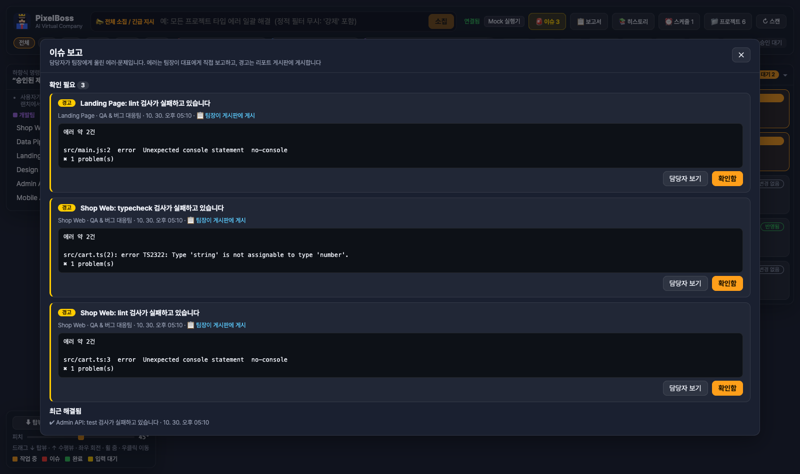 | 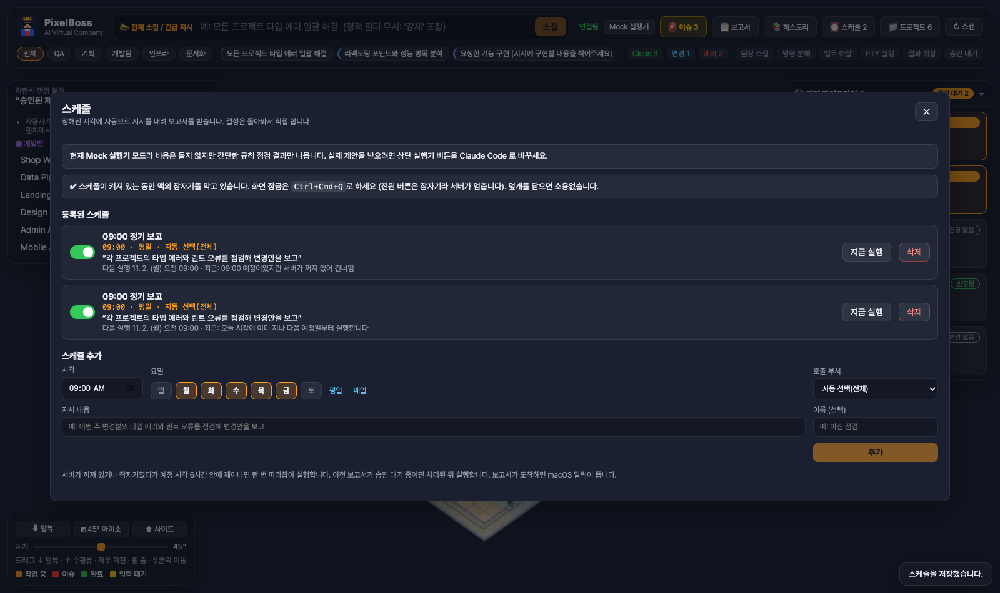 |
| **팀장 브리핑** | **프로젝트 관리** |
| 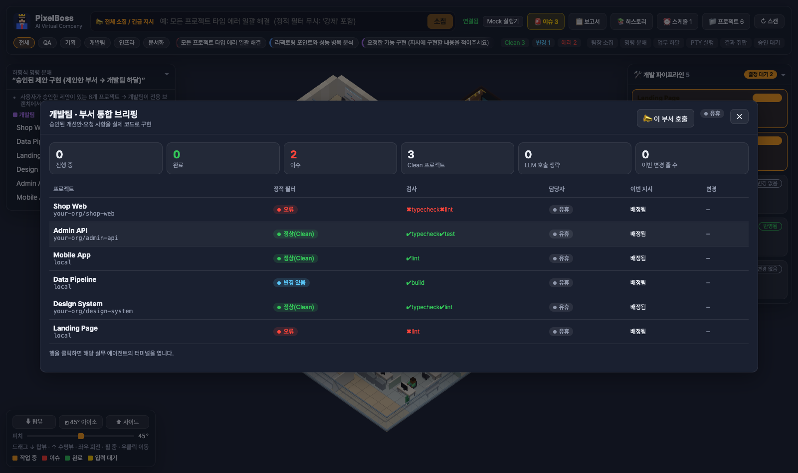 | 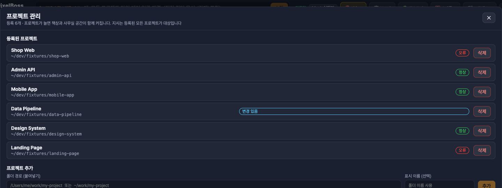 |
| **작업 히스토리** | **실무자 터미널** |
| 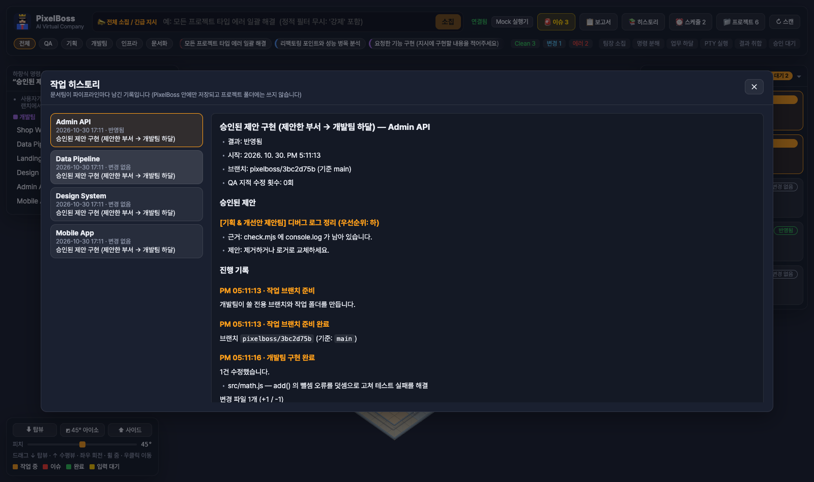 | 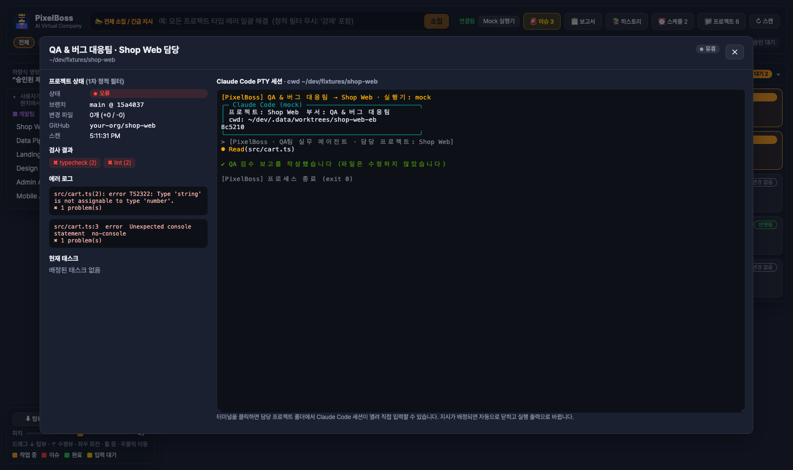 |
| **탑뷰** | **사이드 뷰** |
| 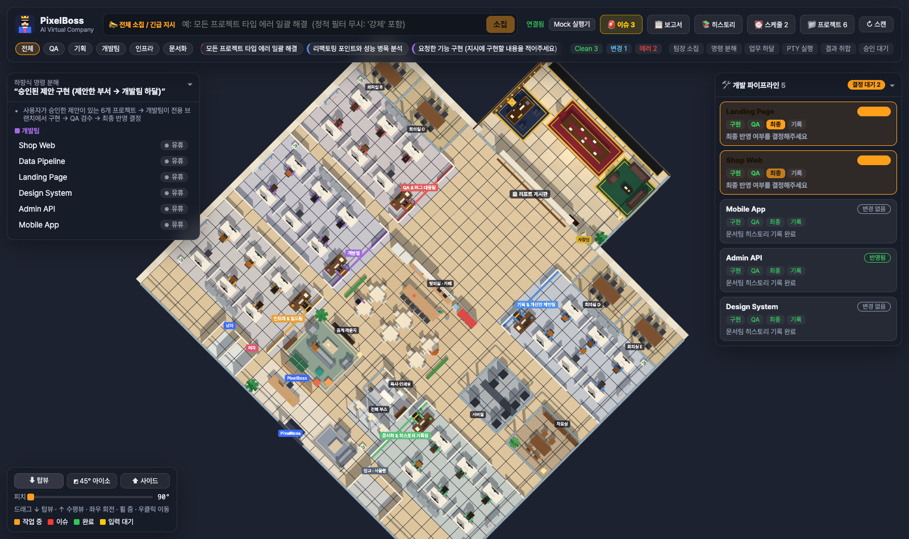 | 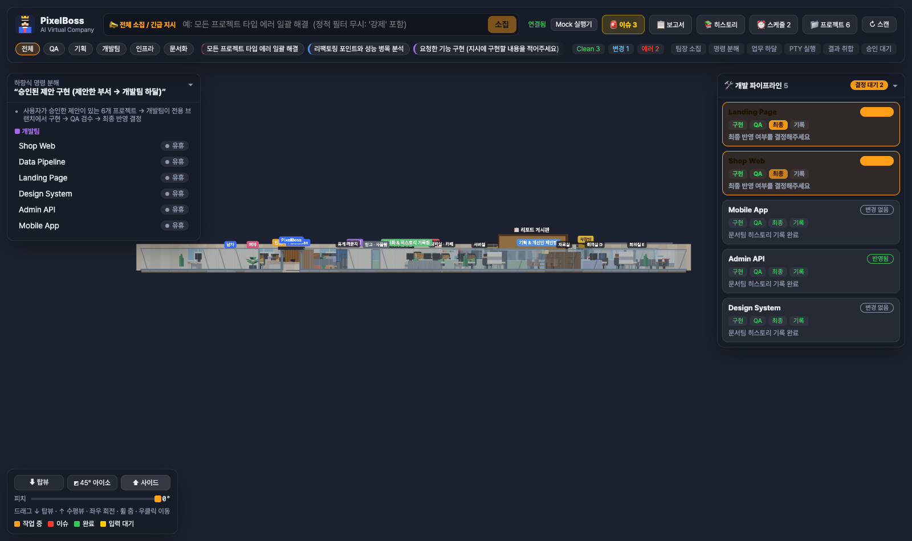 |

## 검증

```bash
pnpm typecheck   # shared / server / web 타입 검사
pnpm verify      # 백엔드 통합 검증: 가상 프로젝트 6개 → 정적 필터 → 소집 → PTY 병렬 → 승인/반려 → Clean 시 토큰 0
pnpm fixtures && pnpm dev   # 다른 터미널에서 ↓
pnpm verify:ui   # 브라우저 통합 검증 (Playwright, 스크린샷은 docs/screenshots)
```

## 구조

```
config/projects.json         대상 프로젝트 템플릿
packages/shared              프론트/백 공용 타입과 WebSocket 프로토콜
apps/server                  Node.js 오케스트레이터
  src/pty-manager.ts         node-pty 다중 세션 관리자 (동시 실행 제한, 입력 대기 감지)
  src/git.ts                 git 델타 감지 + 작업 전후 스냅샷
  src/planner.ts             상위 명령 → 하위 프롬프트 분해
  src/orchestrator.ts        소집 → 분해 → 실행 → 취합 → 제안별 결정
  src/pipeline.ts            개발 파이프라인 (구현 → QA ↔ 수정 → 최종 반영 → 문서 기록)
  src/worktree.ts            프로젝트별 전용 브랜치·작업 폴더(git worktree)
  src/issues.ts              담당자 → 팀장 → 대표 이슈 보고
  src/scheduler.ts           요일·시각별 자동 지시, 놓친 시각 따라잡기
  src/projects.ts            프로젝트 추가·삭제, 폴더 탐색
  bin/claude-stream.mjs      실제 Claude Code 실행 래퍼 (stream-json → 터미널 출력)
  bin/mock-claude.mjs        LLM 없이 흐름을 검증하는 목 실행기
apps/web                     Nuxt 4 + Three.js 프론트엔드
  app/components/            지시창, 보고서·파이프라인·이슈·스케줄·히스토리·프로젝트 모달
  app/utils/voxel/           복셀 월드, 사무실 배치·소품, 캐릭터 FSM, 연출 감독, 카메라
scripts/                     가상 프로젝트 생성, 통합 검증
```
